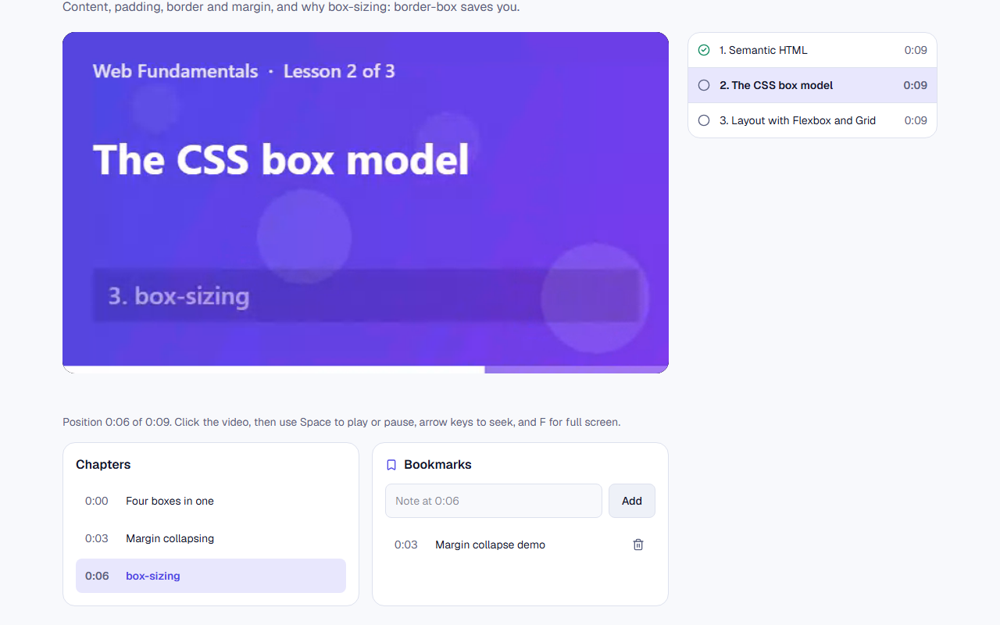
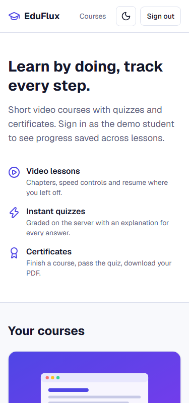
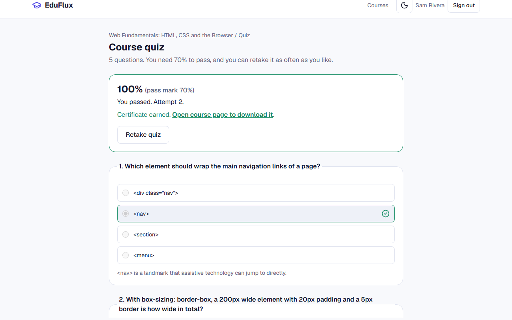
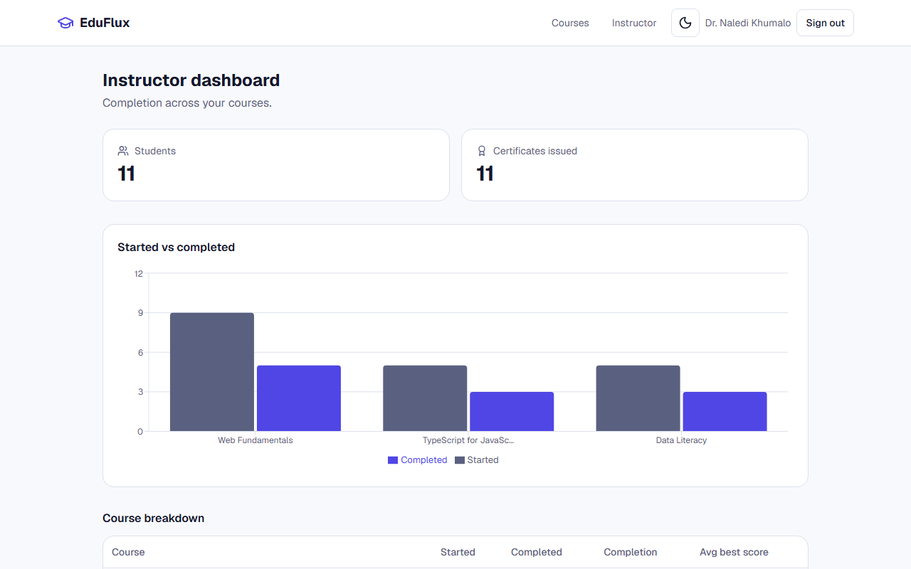

# EduFlux

A small learning platform. Students watch video lessons with chapters and progress tracking, take quizzes that are graded on the server, and download a PDF certificate when they finish. Instructors see completion across their courses.

**Live demo:** https://eduflux-337.netlify.app



## What to demo to a recruiter
- Sign in as the pre-filled demo student: Web Fundamentals is already one lesson in and the second lesson resumes where it was left, because progress is saved to Neon every few seconds.
- Take the quiz and submit a wrong attempt first. Grading happens on the server and the page never contains the answer key; the browser only learns the right answers after you submit.
- Finish the lessons and pass the quiz to unlock the certificate, then open the instructor account to see the completion chart and per-course scores.

## Features
- **Catalog and course pages:** progress bars per course, a Continue button that goes to the next unfinished lesson.
- **Video player:** Video.js with playback speed, chapter list that follows the video, bookmarks with notes, keyboard controls, and resume at the saved position.
- **Progress saving:** throttled saves while playing, plus on pause, on finish and when the tab is hidden. A lesson counts as complete at 90% watched or when it ends, and stays complete.
- **Quiz engine:** multiple choice, pass mark per course, unlimited attempts stored, an explanation for every answer after submitting.
- **Certificates:** issued only when every lesson is watched and the quiz is passed, generated as a PDF with the student's name, course and date.
- **Instructor dashboard:** students started vs completed per course (chart and table), average best quiz score, certificates issued.
- Dark and light theme, responsive from 375px, accessible forms, focus states and chart summary.

### Phase 2
- Instructor tools to create courses and upload materials
- Ratings and feedback per course
- Course search
- Captions for the video lessons

## Stack
Next.js 16 (App Router), React 19, TypeScript (strict), Tailwind CSS 4, Video.js 8, Drizzle ORM with Neon Postgres, Auth.js (credentials, bcrypt), pdf-lib, Recharts, zod, Vitest.

## Architecture notes
- `db/schema.ts` holds the tables (users, courses, lessons, quizzes, questions, attempts, progress, bookmarks, certificates). Migrations are generated into `drizzle/`.
- `lib/queries/` keeps all reads in three small files (catalog, learning, instructor). `lib/course-logic.ts` and `lib/grading.ts` are pure functions with unit tests.
- **Quiz integrity:** the quiz page loads questions through `getQuizPublic`, which never selects `answer_index` or the explanation. `POST /api/quiz/[courseId]/submit` grades on the server and only then returns the correct answers.
- **Certificates:** `ensureCertificate` is idempotent and is the only place a certificate is created. It runs after a lesson completes and after a passing quiz, so the order a student does things in doesn't matter. The PDF route checks eligibility again before building the file.
- **Access control:** write endpoints require a signed-in student; bookmark deletes are scoped to the owner; the instructor page redirects students.
- Video.js runs only inside a client component and is created in an effect, then disposed on unmount.
- Lesson clips are synthetic placeholders generated by `npm run videos`; see `TODO-ASSETS.md`.

## Run locally
```bash
npm install
cp .env.example .env.local        # fill in DATABASE_URL, DATABASE_URL_UNPOOLED, AUTH_SECRET, AUTH_URL
npm run db:migrate                # create the tables in Neon
npm run db:seed                   # 3 courses, a demo student and instructor, sample activity
npm run dev                       # http://localhost:3000
```
Demo logins (password `demo1234`): `sam@eduflux.demo` (student) and `naledi@eduflux.demo` (instructor).

Checks: `npm run typecheck`, `npm run lint`, `npm test`, `npm run build`.

## Screenshots
| Catalog (mobile) | Quiz result | Instructor |
| --- | --- | --- |
|  |  |  |

## Status
Built and tested locally. Deploy pending.
